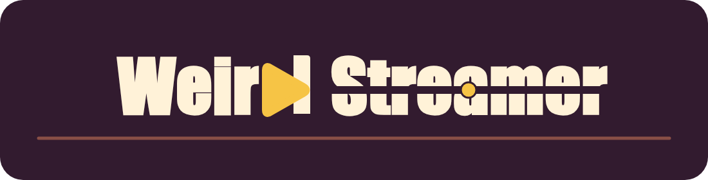

<p align="center">
  <picture>
    <source media="(prefers-color-scheme: dark)" srcset="Logo/wordmark-transparent.png">
    
  </picture>
</p>

Weird Streamer is a self-hosted media server for your own videos, photos and documents. A Go
server indexes your folders and streams them, as they are or transcoded on the fly, to a web UI
and to one Android app that runs on both Android TV and phones.

## Features

- **Libraries:** a library is a folder. Movie and TV libraries are matched on TMDB, for posters,
  titles and seasons; any other folder is browsed as it is, photos and PDFs included.
- **Plays nearly anything:** each player checks what its device or browser can decode, and the
  server copies or transcodes only what it can't play, down to a single audio track. Compatibility
  and size modes are in every player's Transcode menu.
- **DVD images:** ISOs play like any video, with their titles, chapters, angles and audio tracks.
- **Subtitles:** text and picture (PGS) tracks, files beside the video, and search and download
  from OpenSubtitles. Forced subtitles show on their own; choices are remembered per video.
- **Picks up where you left off:** progress is kept per user across every device, with Continue
  Watching, Recently Added, and seek-bar previews.
- **Skips intros and credits** in the Android app, from what the server finds in each season.
- **Offline downloads** on the phone: the original, a copy converted for the phone where it can't
  play the original, or a smaller version, with their subtitles.
- **Users and groups:** each user is in a group, and each library lists the groups that may see
  it. Admins manage libraries, users and groups from Settings on the web or the phone, and see who
  is watching what on the Streams page.
- **The Android app** also browses SMB shares directly, without a server.
- **Runs at home:** HTTPS with HTTP/2, works behind a reverse proxy such as nginx, and keeps sign-in
  and access logs.

## Install

### Server

Download `weirdstreamer-server-<version>-linux-amd64.tar.gz` from the latest release, then:

```bash
tar xzf weirdstreamer-server-*-linux-amd64.tar.gz
cd weirdstreamer-*/
./setup.sh
```

`setup.sh` asks for the server's name, its port and whether to use HTTPS, writes `config.yml`,
and creates the admin user. It can also install a systemd service that starts the server at boot.
Then it opens the web UI. Sign in as the admin: Settings opens where you add your libraries and,
for movie and TV libraries, a TMDB API token.

Without the service, run `./bin/server` from that folder. The server needs `ffmpeg` and
`ffprobe` installed (`sudo apt install ffmpeg`). Every setting is explained in
`config.example.yml`.

### Android app

The server offers the app for download: use the link on the web UI's sign-in page, or in
Settings under My Account. The same APK is attached to each release. It needs Android 10 or
later, and the same app works on Android TV and on phones. Install it from the file
(sideloading), then add your server by its address.

## Build from source

- **Server:** Go 1.24 with a C compiler (for SQLite), and ffmpeg. `Server/start-server.sh` builds
  it, walks through the configuration and runs it. See [Server/README.md](Server/README.md),
  which also covers Docker.
- **Android app:** a JDK 17 or later and the Android SDK, then `./gradlew assembleDebug` in
  `Android/`.
- **A release:** `./release.sh` checks the tools, runs the server tests and builds everything in
  `dist/<version>/`: the server package, the APK and their checksums.

Server tests run from `Server/src`:

```bash
go vet ./internal/... ./cmd/... && go test ./internal/...
```

## Repository layout

| Folder | What's in it |
| --- | --- |
| `Server/src` | The Go server and its CLI (`cmd/server`, `cmd/cli`, `internal/…`) |
| `Server/web` | The web UI (HTML, CSS and JavaScript, no build step) |
| `Server/scripts`, `Server/package` | Building, running and setting up the server |
| `Server/docker` | Running the server in a container |
| `Android` | The Android TV and phone app (Kotlin, Jetpack Compose, ExoPlayer) |
| `Logo` | The app icon and wordmark |

## License

Copyright (C) 2026 Ash Gandhi.

Weird Streamer is free software under the GNU Affero General Public License, version 3 or (at
your option) any later version: see [LICENSE](LICENSE) and [NOTICE](NOTICE). If you run a
modified version for other people over a network, the AGPL asks you to offer them its source.
